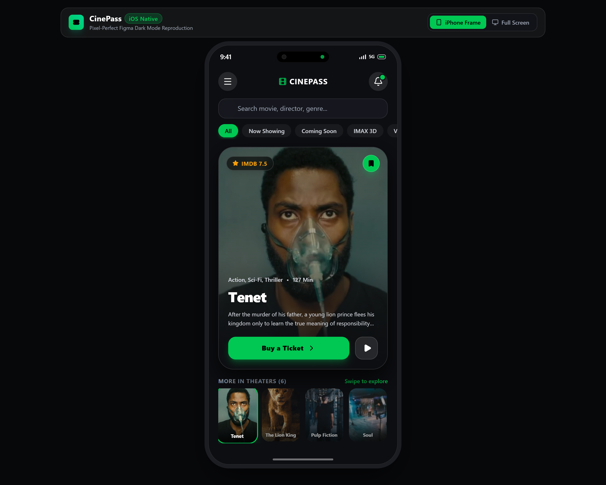
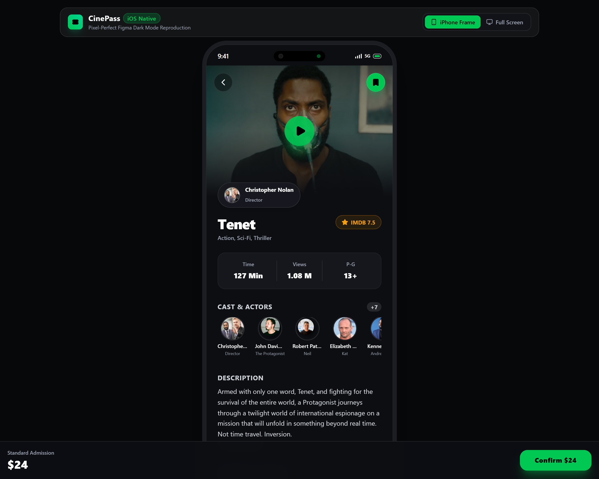
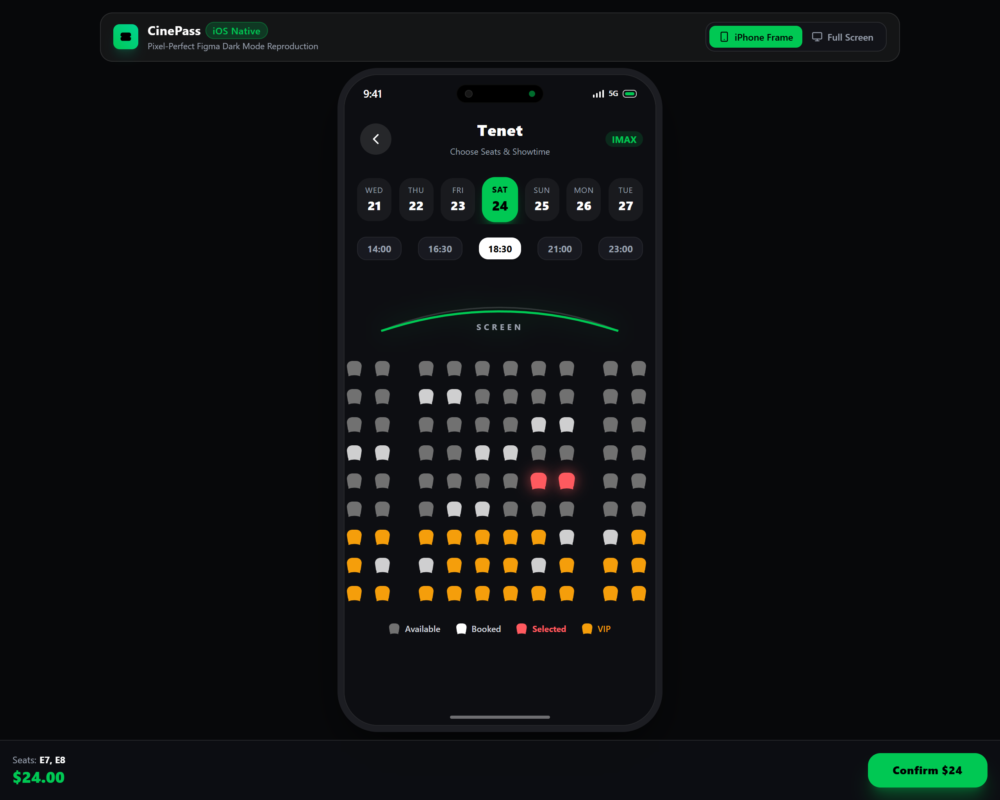
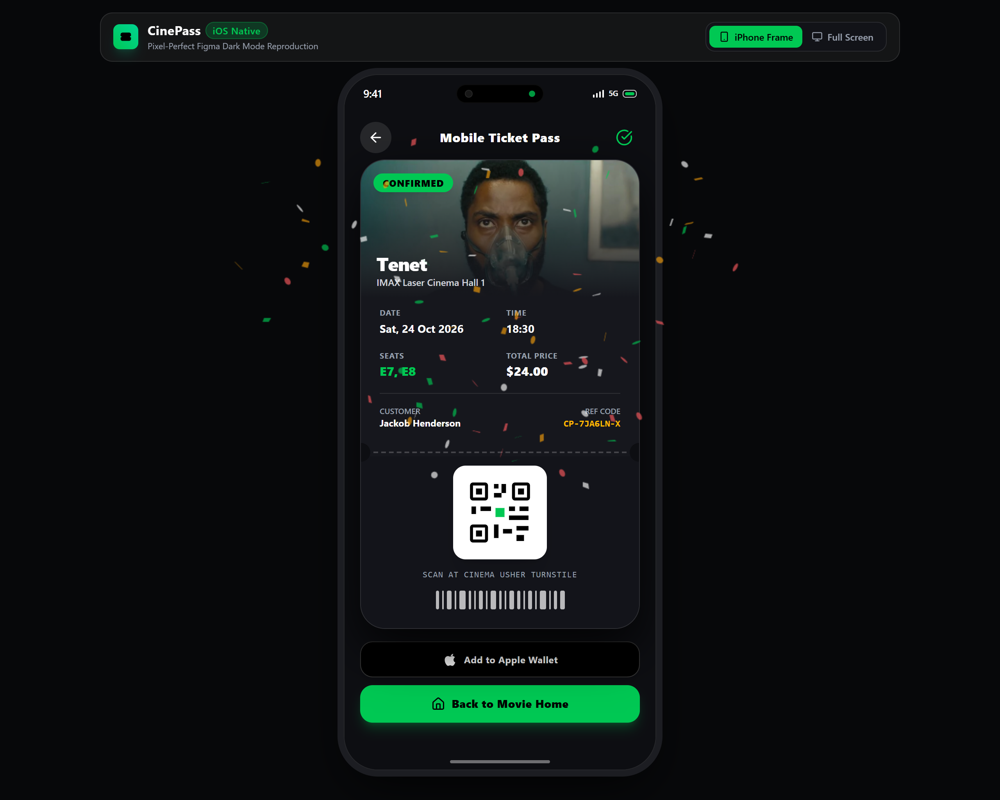
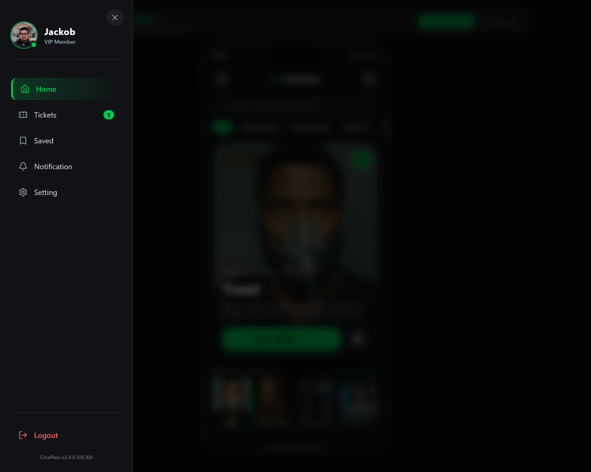
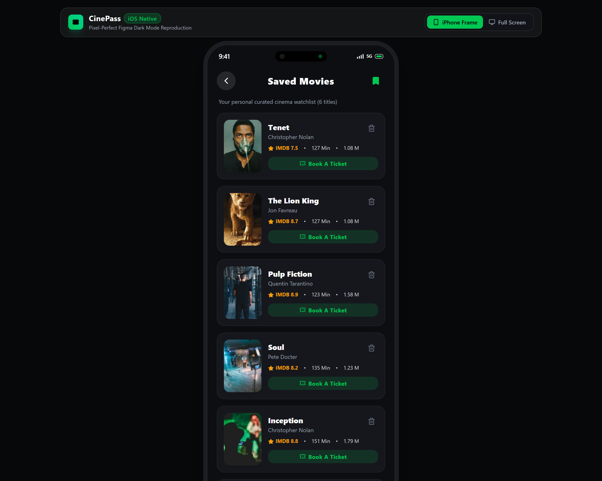
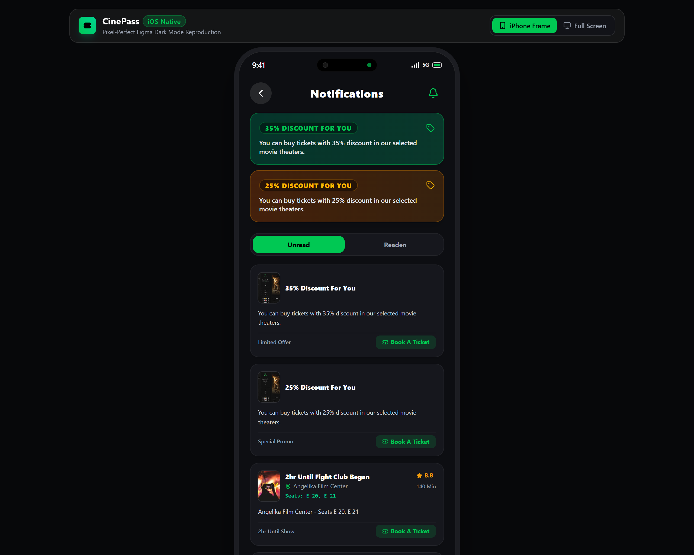
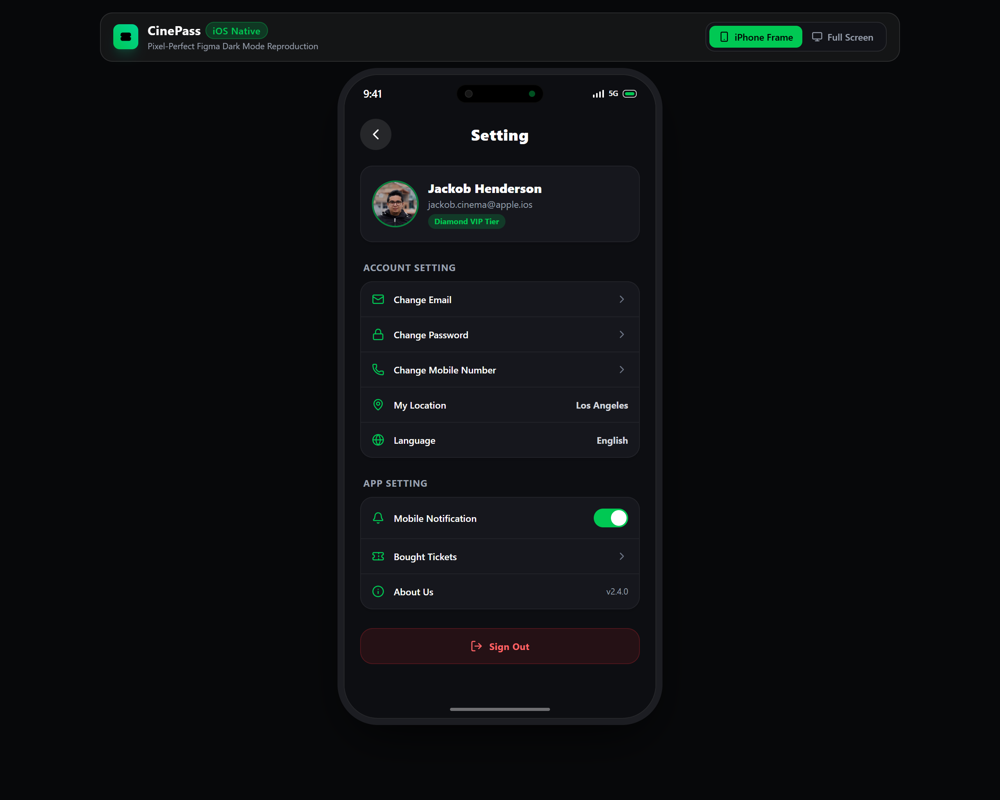

# CinePass - iOS Native Cinema Ticket Booking & Seating Engine

> Production-ready full-stack cinema booking application engineered from Figma Community's iOS UI Kit (*Cinema Ticket UI Kit for iOS* by Alex Arutuynov). Built with **React 19 + Vite + Tailwind CSS v4** on the frontend and **Django 5.2 + Django REST Framework** on the backend.

[](https://lxlnimalxl.github.io/cinepass-cinema-ticket-booking/)
[](https://www.figma.com/design/4g2ALrTNzIkd9bi0gQ9GM5/Cinema-Ticket-UI-Kit-for-iOS--Community-?node-id=181-568)
[](LICENSE)

---

## Showcase Gallery

| 01. Movie Feed & Featured Carousel | 02. Movie Detail (Tenet PDP) |
|:---:|:---:|
|  |  |

| 03. Interactive Seat Matrix & Curved Screen | 04. Confirmed Mobile Boarding Pass |
|:---:|:---:|
|  |  |

| 05. 3D Perspective Drawer Navigation | 06. Saved Watchlist |
|:---:|:---:|
|  |  |

| 07. Notifications & 35% Discount Deals | 08. Account & App Settings |
|:---:|:---:|
|  |  |

---

## Architectural Highlights

- **Dual Device Experience**:
  - **iPhone 15/16 Pro Mobile Shell**: Features realistic Dynamic Island, iOS clock (09:41), cellular 5G signal bars, battery indicator, and bottom home bar.
  - **Expanded Responsive View**: Seamlessly scales to wide desktop screens for fluid cross-platform accessibility.
- **Interactive Cinema Seating Engine**:
  - Exact curved cinema screen SVG vector with neon glow Gaussian filter and "SCREEN" typography.
  - 9x10 seat matrix (Rows A through I) with true 2-6-2 aisle layout and armchair vector geometries.
  - Distinct seat states: Available (`#717171`), Booked (`#FFFFFF`), Selected (`#FF5A5F`), and VIP (`#F59E0B`).
  - Dynamic real-time pricing calculation based on selected seat count.
- **Boarding Pass Ticket Confirmation**:
  - Perforated tear-off edge with circular cut notches.
  - Scannable turnstile barcode and QR code generator.
  - Integration badge for Apple Wallet.
  - Particle physics confetti celebration on booking confirmation.
- **Movie PDP (Product Detail Page)**:
  - Video trailer preview hero with modal video playback.
  - Director badge (Christopher Nolan) with avatar.
  - Movie statistics bar: Time (127 Min), Views (1.08 M), and Age Rating (13+).
  - Cast carousel with Hollywood ensemble avatars.
  - Verified user reviews feed with ratings (Sarah Bilanmarn 9.1, Josh Nova 8.3, Rihana Mizabet 7.4).
- **3D Drawer Navigation**:
  - Native iOS-style folding side menu with user profile (Jackob Henderson) and quick navigation tabs.
- **Saved Watchlist & Promos**:
  - Bookmarked movies (*The Lion King, Pulp Fiction, Soul, Inception, Fight Club*).
  - Discount promo alerts (35% & 25% discount vouchers) and countdown showtime alerts.

---

## Technology Stack

### Frontend
- **Framework**: React 19 (Hooks, Context, modular component architecture)
- **Bundler & Tooling**: Vite 8 (Ultra-fast HMR and ESM build pipeline)
- **Styling**: Tailwind CSS v4 with modern CSS variables and glassmorphism utilities
- **Icons**: Lucide React
- **Celebration Effects**: Canvas Confetti
- **Testing & Screenshot Automation**: Puppeteer Core

### Backend
- **Framework**: Python 3.13 + Django 5.2
- **REST API**: Django REST Framework (DRF)
- **CORS Support**: django-cors-headers
- **Database**: SQLite (ACID-compliant with automatic seeding)
- **Architecture**: Decoupled RESTful API with automated offline fallback cache for static hosting

---

## Project Structure

```
n12/
├── backend/                        # Django REST API Backend
│   ├── api/                        # App models, serializers, views, urls
│   │   ├── models.py               # Movie, CastMember, Review, Showtime, Seat, Booking, NotificationItem
│   │   ├── serializers.py          # DRF Serializers
│   │   ├── views.py                # REST API Endpoints & seat booking logic
│   │   └── urls.py                 # API Routing
│   ├── core/                       # Django project settings & configuration
│   ├── seed.py                     # Database population script
│   ├── manage.py
│   └── db.sqlite3
├── src/                            # React 19 Frontend
│   ├── assets/
│   │   └── images/                 # High-resolution extracted Figma assets & SVGs
│   ├── components/
│   │   ├── booking/                # SeatBookingView & TicketConfirmationView
│   │   ├── layout/                 # MobileShell & NavigationDrawer
│   │   ├── movies/                 # MovieFeed & MovieDetailPage
│   │   ├── notifications/          # NotificationsView
│   │   ├── saved/                  # SavedWatchlistView
│   │   └── settings/               # SettingsView
│   ├── services/
│   │   └── api.js                  # Hybrid DRF client with offline persistence fallback
│   ├── App.jsx                     # Master state controller
│   ├── index.css                   # Tailwind v4 styles & design tokens
│   └── main.jsx
├── screenshots/                    # High-resolution screen captures
├── capture_screenshots.cjs         # Automated headless browser screenshot generator
├── index.html
├── package.json
└── vite.config.js
```

---

## Quickstart Guide

### 1. Prerequisites
- **Node.js**: v18+ (Node 20+ recommended)
- **Python**: v3.10+ (Python 3.13 recommended)

### 2. Frontend Setup
```bash
# Clone the repository
git clone https://github.com/lxlnimalxl/cinepass-cinema-ticket-booking.git
cd cinepass-cinema-ticket-booking

# Install dependencies
npm install

# Run Vite dev server
npm run dev
```
Open [http://localhost:5173](http://localhost:5173) in your browser.

### 3. Backend Setup (Optional for Local API Server)
```bash
cd backend

# Apply database migrations
python manage.py migrate

# Seed database with initial Figma dataset
python seed.py

# Launch Django development server
python manage.py runserver 8000
```
The REST API will be available at [http://127.0.0.1:8000/api/](http://127.0.0.1:8000/api/).

---

## API Endpoints

| Method | Endpoint | Description |
|:---|:---|:---|
| `GET` | `/api/movies/` | List all movies with optional `?saved=true` and `?search=` filters |
| `GET` | `/api/movies/<id>/` | Retrieve movie detail with nested cast, reviews, and showtimes |
| `POST` | `/api/movies/<id>/toggle-save/` | Toggle saved/watchlist status for a movie |
| `GET` | `/api/showtimes/<id>/seats/` | Retrieve 9x10 seat reservation matrix for a showtime |
| `POST` | `/api/bookings/` | Create a new seat reservation and generate boarding pass |
| `GET` | `/api/bookings/<booking_code>/` | Retrieve confirmed boarding pass details |
| `GET` | `/api/notifications/` | List discount offers, promos, and showtime countdown alerts |
| `POST` | `/api/notifications/<id>/read/` | Mark a notification item as read |
| `GET` | `/api/system/overview/` | Service health status and database statistics |

---

## Author & Contact

**Seyyed Nima Rounaghi**
- **GitHub**: [@lxlnimalxl](https://github.com/lxlnimalxl)
- **Role**: Full-Stack Software Engineer & UI/UX Designer
